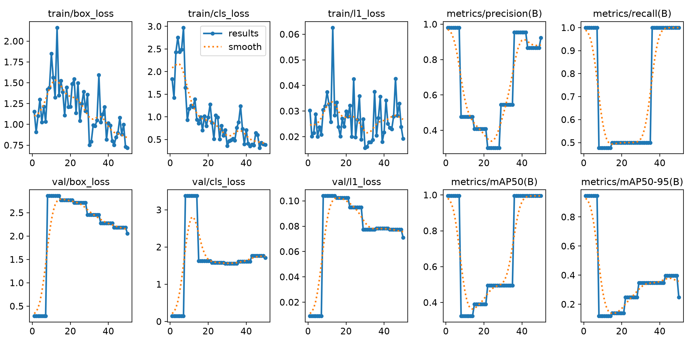
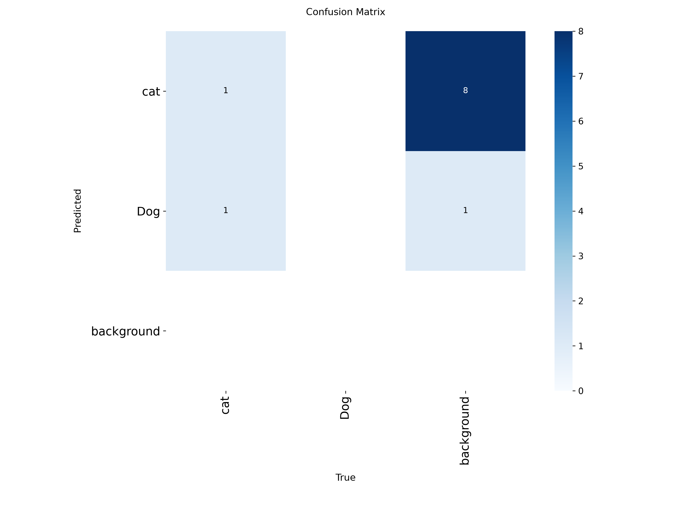
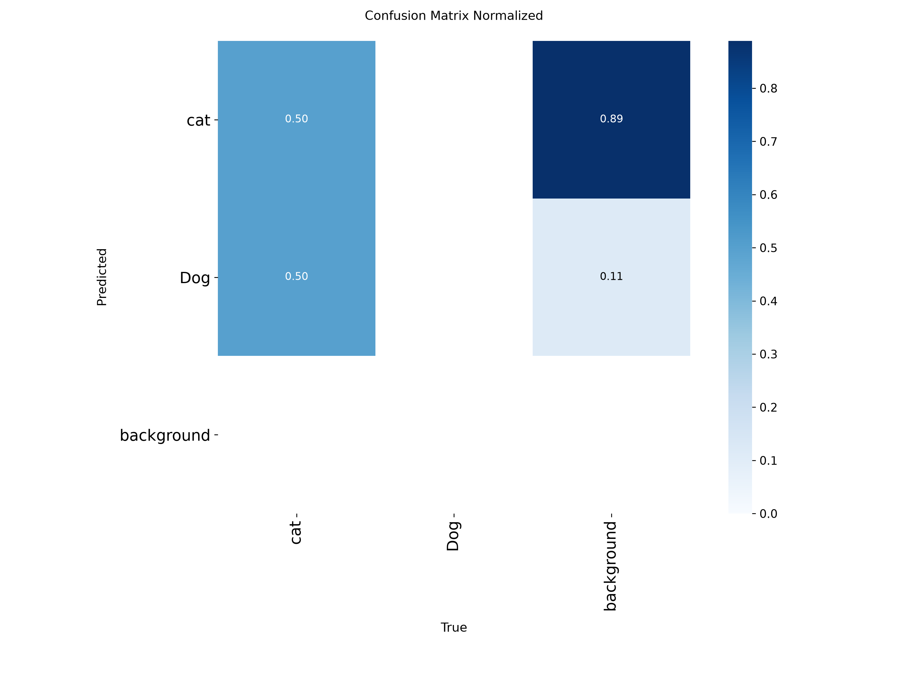
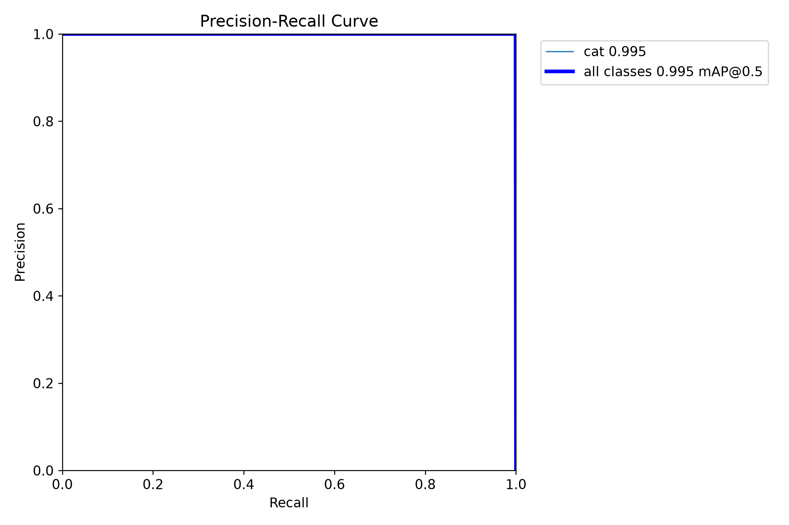
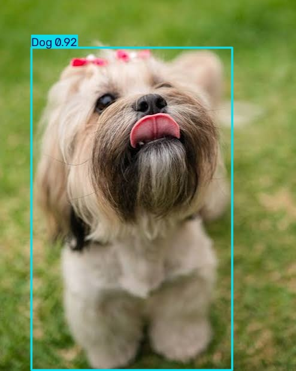
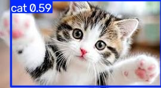

# YOLOv8-Object-Detection

## Overview
This project demonstrates object detection using YOLOv8, Python, and computer vision techniques.

## Technologies
- Python
- YOLOv8
- OpenCV
- Computer Vision

## Features
- Detect objects in images.
- Display predicted classes and confidence scores.
- Support experimentation with custom-trained models.

## Project Status
Project documentation and code are being organized.

## Training Results

The model was trained to detect cats and dogs using YOLOv8.

Training evaluation plots and confusion matrices are available in the [results](results/) directory.ory.

### Results Preview

#### Training Metrics


#### Confusion Matrix


#### Normalized Confusion Matrix


#### Precision-Recall Curve


## Detection Examples

### Dog Detection


### Cat Detection


View more details in the [examples folder](examples/).

## Author
Mahmoud Elbalat

## Installation

Clone the repository:

```bash
git clone https://github.com/MahmoudSalah2002/YOLOv8-Object-Detection.git
cd YOLOv8-Object-Detection
```

Install the required dependencies:

```bash
pip install -r requirements.txt
```

## Usage

To run object detection, use the trained YOLOv8 model with an image:

```bash
yolo detect predict model=weights/best.pt source=path/to/image.jpg
```

Replace `path/to/best.pt` with the location of your trained model weights, and `path/to/image.jpg` with the image you want to test.

## Supported Classes

- Cat
- Dog

## Training the Model

The model was trained using YOLOv8n with the following settings:

- **Epochs:** 50
- **Image Size:** 640 × 640
- **Batch Size:** 8
- **Classes:** Cat and Dog

### Prepare the Dataset

Run the dataset preparation script:

```bash
python prepare_dataset.py
```

Make sure the dataset is available and the generated `data.yaml` file is in the expected location.

### Start Training

Run the training script:

```bash
python train.py
```

Training results and model weights will be saved in the `runs/detect` directory.

The best-performing weights are saved as `best.pt`.


## Live Webcam Detection

Run real-time object detection using your webcam:

```bash
yolo predict model=weights/best.pt source=0
```

Press `q` to stop the webcam prediction window.

## Project Highlights

- Custom-trained YOLOv8 model for cat and dog detection.
- Image-based object detection with confidence scores.
- Real-time webcam detection.
- Training metrics and evaluation visualizations.

